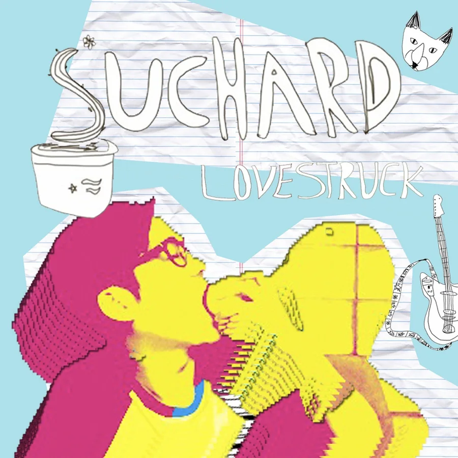
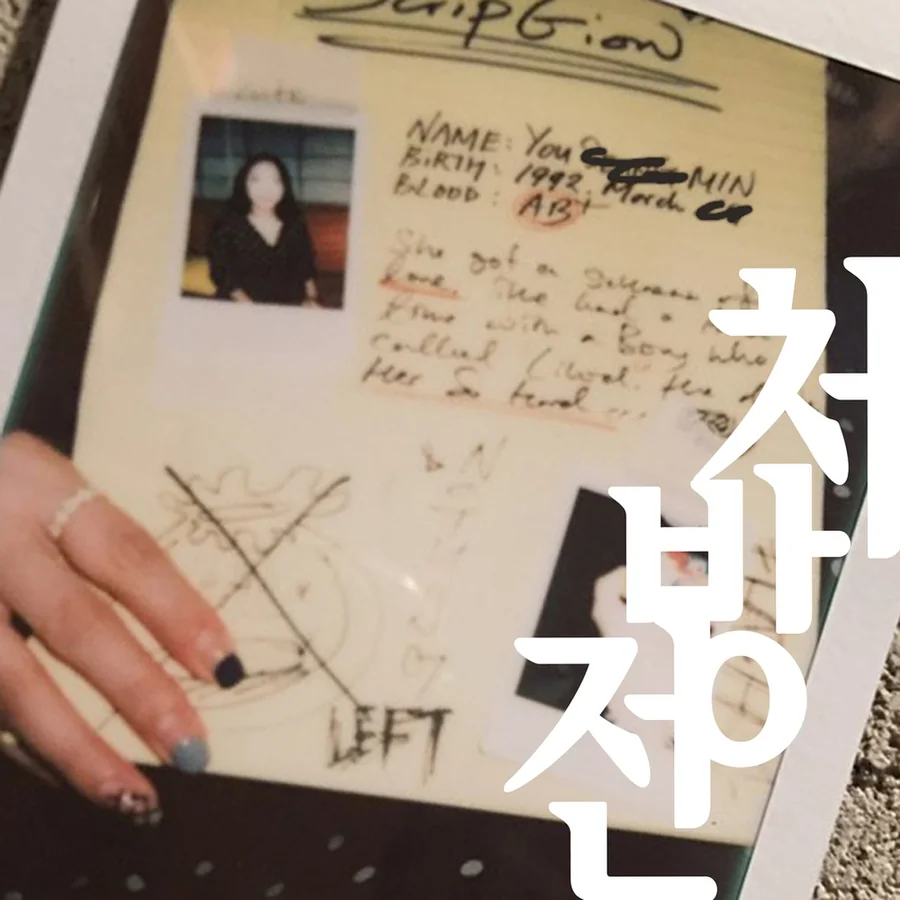
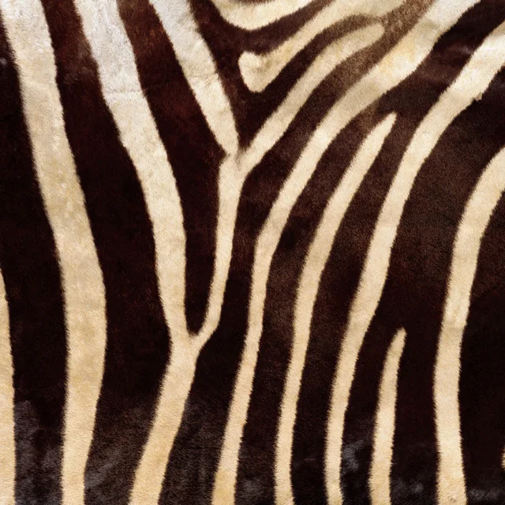
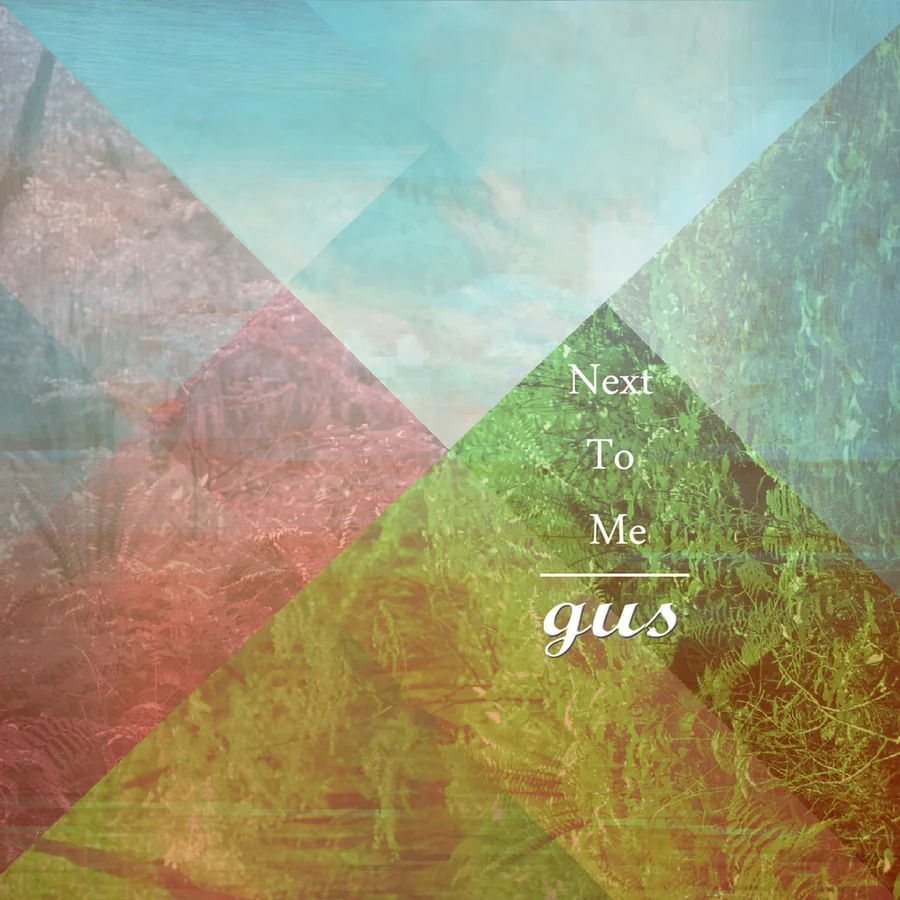
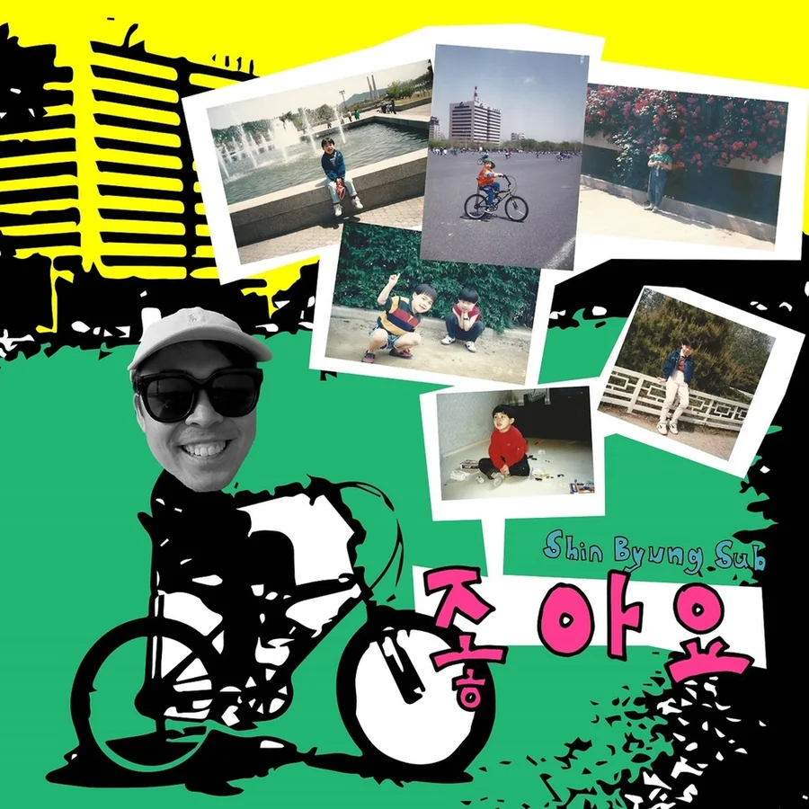
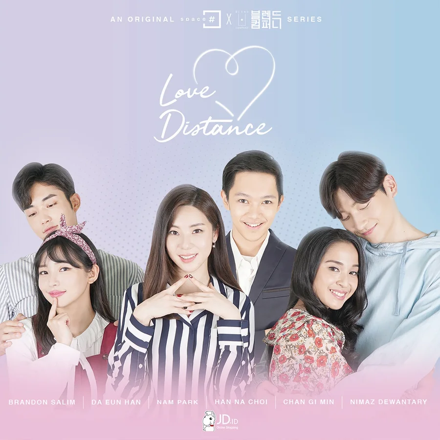

  

  # SUCHARD · 슈샤드

  **Musician · Composer · Producer**

  몽구스 · 솔로 · 프로듀싱

  Mongoose · Solo · Production

  [한국어](https://suchard-ent.github.io/suchard-ent/ko/) · [English](https://suchard-ent.github.io/suchard-ent/en/) · [日本語](https://suchard-ent.github.io/suchard-ent/ja/)

---

## 슈샤드 · About

슈샤드(박희정)는 밴드 **몽구스(Mongoose)**에서 베이스와 기타를 연주했다. 몽구스의 두 번째 음반 《Dancing Zoo》(2005)는 **2006년 한국대중음악상 최우수 모던록 음반**을 수상했다.

2015년 첫 솔로 싱글 **〈Lovestruck〉**를 발표했다. 이듬해 공개한 **〈처방전〉**에서는 작곡과 편곡, 보컬과 악기 연주, 프로듀싱과 믹싱을 맡았다.

이 밖에도 GUS, 신병섭, 드레인(Drain), 스타치스(Starchis)의 음악에 작곡·편곡·프로듀싱 또는 세션 연주로 참여했다.

Suchard (Park Hee-jung) played bass and guitar in the Korean band **Mongoose**. The band's second album, *Dancing Zoo* (2005), won **Best Modern Rock Album** at the 2006 Korean Music Awards.

He released his first solo single, **Lovestruck**, in 2015. On **Prescription** (2016), he composed and arranged the music, performed vocals and instruments, and handled production and mixing. He has also worked on recordings by GUS, Shin Byung-seop, Drain and Starchis.

**日本語**

SUCHARD（パク・ヒジョン）は、韓国のバンド**Mongoose**でベースとギターを担当。Mongooseのセカンドアルバム『Dancing Zoo』（2005年）は、2006年の韓国大衆音楽賞で最優秀モダンロック・アルバム賞を受賞した。

2015年に初のソロ・シングル**『Lovestruck』**を発表。翌年の**『처방전（Prescription）』**では、作曲・編曲、ボーカル、楽器演奏、プロデュース、ミキシングを手がけた。GUS、シン・ビョンソプ、Drain、Starchisの作品にも制作や演奏で参加している。

---

## 주요 음반 · Selected Recordings

| | | |
| :---: | :---: | :---: |
|  |  |  |
| **Lovestruck** · 2015 | **처방전 / Prescription** · 2016 | **Dancing Zoo** · 2005 |
| Solo single | Solo single | Mongoose |

| | | |
| :---: | :---: | :---: |
|  |  |  |
| **Next To Me** · 2016 | **좋아요** · 2017 | **사랑, 아마도** · 2018 |
| GUS · Production / Guitar / Mixing | 신병섭 · Production / Guitar / Bass | Drain · Production / Arrangement / Mixing |

---

## 음악 듣기 · Listen

[**Spotify — Mongoose**](https://open.spotify.com/artist/33NSPHPUhk5VQNkkMUv6fF) · [**YouTube — Suchard**](https://www.youtube.com/watch?v=-oU884kEfpg) · [**Bandcamp — Suchard**](https://blendcompany.bandcamp.com/album/prescription) · [**SoundCloud — Mongoose**](https://soundcloud.com/band-mongoose)

---

  **Contact · お問い合わせ · 작업 문의:** [suchard337@gmail.com](mailto:suchard337@gmail.com)

  SUCHARD · MUSICIAN / COMPOSER / PRODUCER

